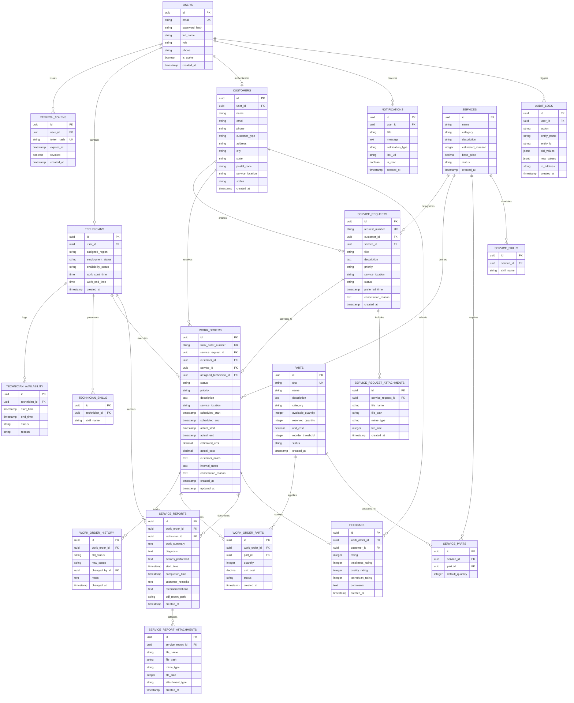

# Entity-Relationship Architecture & Database Schema

## 1. System Overview
The **ServiSync Pro** platform is engineered with a relational PostgreSQL database schema. The architecture guarantees:
- **Strict Referential Integrity**: Foreign keys with indexed lookup constraints.
- **Race Condition Immunity**: Pessimistic row-level locking (`SELECT ... FOR UPDATE`) during technician assignment and inventory deduction.
- **Auditing & Traceability**: Work order status state transitions, technician assignment logs, and security events are stored immutably.

---

## 2. Mermaid Entity-Relationship Diagram



---

## 3. Concurrency & Integrity Mechanics

### 3.1 Overlap Prevention Algorithm
Technician assignment checks the mathematical condition:
$$\text{Overlap} \iff \max(\text{start}_A, \text{start}_B) < \min(\text{end}_A, \text{end}_B)$$
Equivalently:
$$\text{start}_A < \text{end}_B \quad \text{and} \quad \text{end}_A > \text{start}_B$$
Query executed with pessimistic locking:
```python
conflicts = db.query(WorkOrder).filter(
    WorkOrder.assigned_technician_id == tech_id,
    WorkOrder.status.in_([WorkOrderStatus.SCHEDULED.value, WorkOrderStatus.ASSIGNED.value, WorkOrderStatus.IN_PROGRESS.value]),
    WorkOrder.scheduled_start < new_end,
    WorkOrder.scheduled_end > new_start
).with_for_update().all()
```

### 3.2 Inventory Race Condition Prevention
When a technician issues parts on site:
```python
part = db.query(Part).filter(Part.id == part_id).with_for_update().first()
if part.available_quantity < requested_qty:
    raise InsufficientInventoryException("Stock depleted")
part.available_quantity -= requested_qty
part.reserved_quantity += requested_qty
```
This guarantees zero negative inventory anomalies under high transaction volume.
